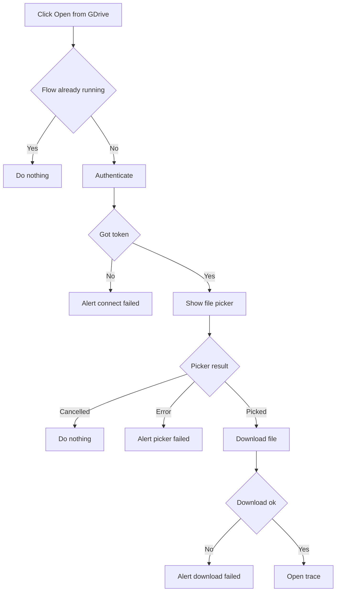
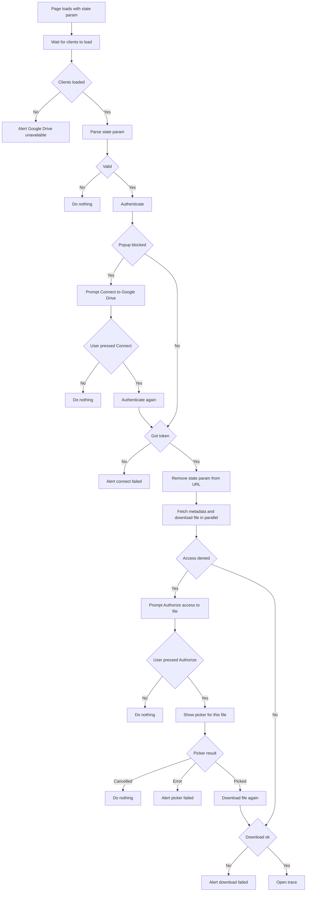
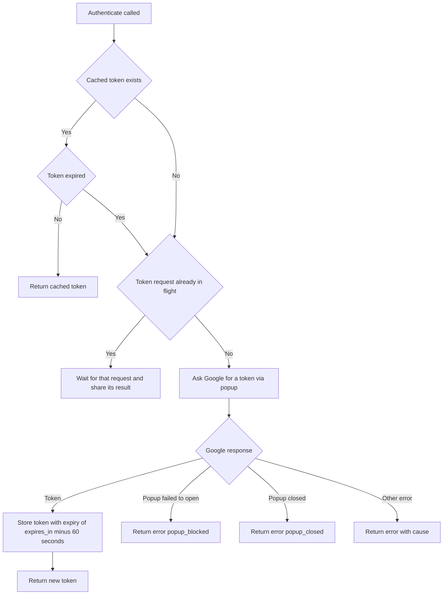

# dev.perfetto.GoogleDrive

Opens traces from Google Drive, either through the "Open from GDrive" sidebar
button (file picker) or through Drive's "Open with" deep link
(`?state=<json>`).

## Flows

### Sidebar flow (openFileFromSidebar)



### Deep link flow (openFileFromDeeplink)



### Authenticate step (GoogleOAuthClient authenticate)

Every "Authenticate" box above runs this. It never throws: every outcome is
returned as a Result.



## Manual testing

There are no automated tests for the Google connection and Drive flows, so
they need checking by hand. Keep this list up to date when adding a flow or a
failure mode.

### Checklist

Happy paths:

- [ ] [Sidebar flow](#sidebar-flow)
- [ ] [Token reuse within a session](#token-reuse-within-a-session)
- [ ] ["Open with" deep link](#open-with-deep-link)
- [ ] [Resource key](#resource-key)
- [ ] [Drive traces are not shareable](#drive-traces-are-not-shareable)

Button visibility:

- [ ] [Internal user](#button-visibility)
- [ ] [Non-internal user](#button-visibility)
- [ ] [Non-internal user with the external users flag](#button-visibility)
- [ ] [Initialisation fails](#initialisation-fails)
- [ ] [Plugin disabled](#plugin-disabled)

Failure modes:

- [ ] [Popup blocked](#popup-blocked-connect-to-google-drive-dialog)
- [ ] [Connection failure](#connection-failure-couldnt-connect-to-google-drive-dialog)
- [ ] [Google popup closed](#google-popup-closed)
- [ ] [File not yet authorised](#file-not-yet-authorised-authorize-access-to-file-dialog)
- [ ] [Initialisation fails, with a deep link](#initialisation-fails)
- [ ] [Invalid deep link payload](#invalid-deep-link-payload)
- [ ] [Download failures](#download-failures)
- [ ] [Picker failures](#picker-failures)

### Setup

1. Run `ui/run-dev-server` and open `http://localhost:10000`.
2. The plugin is not enabled by default. Open
   `http://localhost:10000/#!/plugins`, enable `dev.perfetto.GoogleDrive` and
   reload.
3. `http://localhost:10000` must be an authorised JavaScript origin on the
   OAuth client named in the config. If the picker works locally, it is.
4. The sidebar button is only shown to internal users, see
   [Button visibility](#button-visibility).
5. The access token is only kept in memory, so every page load starts
   disconnected.
6. Everything Google Drive support needs is loaded once, on every page load:
   the config and Google's scripts. See
   [Initialisation fails](#initialisation-fails).

Every "I give up" dialog (connection, picker and download failures) has an
"OK" button only, and no retry. Where there is an underlying error, it is
shown in a collapsed "Error details" section of the dialog rather than logged
to the console.

Two DevTools techniques are used below:

- **Block a request:** in the Network tab, right-click a request and choose
  "Block request URL" (or add a pattern in the "Network request blocking"
  drawer tab), then reload.
- **Build a deep link:** see ["Open with" deep link](#open-with-deep-link).

### Sidebar flow

1. Click "Open from GDrive" in the sidebar.
2. Complete the Google popup if it asks.
3. Pick a trace in the picker. It should open, titled with the file's name.
4. Cancel the picker instead of picking: nothing should happen.
5. Clicking the button again while a flow is still running (e.g. while the
   picker is open) should do nothing.

### Token reuse within a session

1. Complete the sidebar flow once.
2. Without reloading, click "Open from GDrive" again.
3. The picker should open straight away, with no Google popup.

The token is reused until about a minute before it expires (normally an hour).
After that, or after a page reload, the Google popup is needed again.

### "Open with" deep link

Drive opens the UI with a `state` query parameter naming the file. To
reproduce that without going through Drive, paste a URL like this into the
address bar of a new tab:

```
http://localhost:10000/?state=%7B%22ids%22%3A%5B%22<FILE_ID>%22%5D%2C%22action%22%3A%22open%22%7D
```

That is `{"ids":["<FILE_ID>"],"action":"open"}` URL-encoded. Take `<FILE_ID>`
from a Drive link (`https://drive.google.com/file/d/<FILE_ID>/view`).

Expected:

1. Unless popups are allowed for the site, the "Connect to Google Drive"
   dialog appears first, see
   [Popup blocked](#popup-blocked-connect-to-google-drive-dialog).
2. Once connected, the trace loads, titled with the file's real name. The
   deep link only carries the file ID, so the name is looked up from Drive
   with a separate metadata request, in parallel with the download.
3. The `state` parameter is removed from the address bar once connected. It
   stays if the user cancels the "Connect to Google Drive" dialog or
   connecting fails, so reloading retries the deep link.

The deep link is not restricted to internal users.

If the name lookup fails the trace should still open, titled "Google Drive
file", and a warning is logged to the console. To check, block
`*fields=name*` in DevTools and load the deep link again.

#### From a real "Open with" click

The app is registered with Google Drive as an "Open with" app, so the real
flow can be tested too:

1. Connect through the UI at least once (e.g. with the sidebar flow).
   Granting access is what adds Perfetto to your Drive's "Open with" menu.
2. In Drive, right-click a trace, choose "Open with" and pick Perfetto. Drive
   opens the registered URL with a `state` parameter for that file.
3. To land on a local build instead of the registered URL, use a redirect
   extension (e.g. Requestly) to rewrite the registered URL to
   `http://localhost:10000/`, keeping the query string.

A file opened this way should already be authorised, so it should load without
the "Authorize access to file" dialog.

### Resource key

Some link-shared files need a resource key as well as the file ID. Their links
look like `.../file/d/<FILE_ID>/view?resourcekey=<KEY>`. To test one, use a
file you do not own and have not opened before, and add the key to the state
payload:

```json
{"ids":["<FILE_ID>"],"action":"open","resourceKeys":{"<FILE_ID>":"<KEY>"}}
```

URL-encode it and load it as the `state` parameter. In the DevTools Network
tab, the Drive download and metadata requests should carry the header
`X-Goog-Drive-Resource-Keys: <FILE_ID>/<KEY>`.

### Drive traces are not shareable

Drive traces are access-controlled, so they must not be uploaded to the public
permalink bucket.

1. Open a trace from Drive by either route.
2. The UI should not offer to share it or create a permalink for it.

### Button visibility

The "Open from GDrive" button is shown only when both of these hold:

- the user is internal, meaning the UI could fetch the manifest from the
  internal extension server (this needs a corp login), or the "Enable Google
  Drive integration for external users" flag is on, and
- initialisation succeeded: the config and Google's scripts all loaded.

Both are resolved shortly after startup, so the button can appear a moment
after the page loads.

To test:

1. **Internal user:** with a corp login, load the UI. The button should appear
   just below "Open trace file".
2. **Non-internal user:** block requests to
   `perfetto-gae-internal.googleplex.com` and reload. The button should not
   appear. The result of this check is cached in `localStorage.isInternalUser`
   and refreshed on every load.
3. **Non-internal user with the flag:** still as a non-internal user, open the
   flags page (`#!/flags`), enable "Enable Google Drive integration for
   external users" and reload. The button should now appear, and the sidebar
   flow should work with a non-corp Google account. The flag is listed on
   every deployment, not just localhost. Turn it off afterwards.

### Initialisation fails

On every page load the plugin loads, in order:

1. the config (API key, client ID and app ID), from
   `https://storage.googleapis.com/perfetto-misc/gdrive_config.json`,
2. Google's sign-in library, from `https://accounts.google.com/gsi/client`,
3. Google's API loader script, from `https://apis.google.com/js/api.js`,
4. the picker module, also from `apis.google.com`.

None of this opens a popup. If any step fails, "Failed to initialize Google
Drive" is logged to the console (with the failing step as its cause) and
nothing else is shown: no error dialog, as this runs for every user on every
load.

For each of the URLs above in turn:

1. Block it and reload.
2. The "Open from GDrive" button should not appear, even for an internal user.
   The console should show "Failed to initialize Google Drive".
3. Load a deep link URL with the request still blocked. A "Google Drive
   unavailable" dialog should appear, and the `state` parameter should stay in
   the address bar.
4. Unblock the URL and reload the same deep link. It should now proceed.

Also check that with everything blocked the rest of the UI works normally,
e.g. opening a local trace.

The config fetch times out after 5 seconds, and each of the other steps after
30 seconds. Until initialisation finishes, a deep link shows nothing. A failed
initialisation is not retried until the page is reloaded.

### Plugin disabled

The plugin is not enabled by default, so this is the state on a fresh profile.

1. Open `http://localhost:10000/#!/plugins`, make sure
   `dev.perfetto.GoogleDrive` is disabled, then reload.
2. The "Open from GDrive" button should not appear.
3. In the DevTools Network tab there should be no requests for the config or
   for Google's scripts (see [Initialisation fails](#initialisation-fails) for
   the URLs).
4. Loading a deep link URL should do nothing.
5. Re-enable the plugin afterwards.

### Popup blocked ("Connect to Google Drive" dialog)

This only happens on a deep link: the sidebar flow starts from a click, so the
browser allows the popup.

1. Make sure popups are not set to "Allow" for `localhost:10000`
   (`chrome://settings/content/popups`).
2. Load the deep link URL and do not click anything while it loads.
3. The "Connect to Google Drive" dialog should appear, including a hint that
   allowing pop-ups for the site skips this step.
4. Click "Connect". The Google popup should open, and once it completes the
   trace should load without a page reload.
5. Repeat and click "Cancel" instead. The dialog should close and nothing else
   should happen.
6. Set popups to "Allow" for `localhost:10000` and load the deep link again.
   The dialog should not appear; the Google popup should open by itself.

After "Connect" the popup is opened shortly after the click rather than inside
it, which Chrome allows. Other browsers may block it again, in which case the
"Couldn't connect to Google Drive" dialog appears saying the popup was
blocked.

### Connection failure ("Couldn't connect to Google Drive" dialog)

This is shown when Google reports an error while connecting, for example
because the user refuses to grant access.

1. Use a Google account that has not yet granted Perfetto access to Drive (or
   remove Perfetto's access from the account's third-party access page first).
2. Click "Open from GDrive", or load the deep link URL.
3. On Google's consent screen, press "Cancel" rather than granting access.
4. The "Couldn't connect to Google Drive" dialog should appear with Google's
   error, and the same error under "Error details", rather than the generic
   crash dialog.
5. "OK" dismisses it and ends the flow. Start again from the sidebar button or
   by reloading the deep link.

### Google popup closed

1. Set popups to "Allow" for `localhost:10000`, or start from the sidebar
   button.
2. When the Google popup opens, close it without completing it.
3. The "Couldn't connect to Google Drive" dialog should appear, saying the
   window was closed. There is no "Error details" section for this case.
4. "OK" dismisses it and ends the flow. Clicking the sidebar button again
   should reopen the popup; reloading a deep link should retry it.

### File not yet authorised ("Authorize access to file" dialog)

The app can only read files the user has opened or picked with it.

1. Set popups to "Allow" for `localhost:10000`.
2. Load the deep link URL with the ID of a file that has never been opened or
   picked through this app.
3. The download should fail with HTTP 403 or 404 and the "Authorize access to
   file" dialog should appear.
4. Click "Authorize File Access". The dialog closes and the picker opens,
   showing only that file. Pick it, and the trace should open, titled with the
   file's real name.
5. Repeat and click "Cancel" in the dialog, or cancel the picker: the flow
   should end silently.

Drive reports a file the app has not been granted as "not found", the same as
a file that does not exist. So a deep link with a made-up file ID also shows
this dialog; the picker it opens will then have nothing to pick.

### Invalid deep link payload

Each of these should be ignored silently: no dialog, no Google popup, and the
`state` parameter left in the address bar.

- `?state=not-json`
- `?state=%7B%22ids%22%3A%22abc%22%7D` (`ids` is not an array)
- `?state=%7B%22ids%22%3A%5B%5D%7D` (no file ID)
- A file ID or resource key containing anything other than letters, digits,
  `_` and `-`, e.g. `{"ids":["../x"]}`.

This assumes initialisation succeeded. The payload is only parsed after the
clients have loaded, so if initialisation fails any `state` parameter, valid
or not, shows the "Google Drive unavailable" dialog.

### Download failures

The easiest way to make only the download fail is to block
`*googleapis.com/drive/v3/files/*alt=media*` in DevTools: connecting, the
picker and the name lookup still work.

A failed download shows a "Couldn't open <file name> from Google Drive" dialog
(or "Couldn't open file from Google Drive" if the name is not known), with the
underlying error under "Error details".

The one exception is when Drive refuses access to the file (HTTP 403 or 404)
on a deep link: that shows the "Authorize access to file" dialog instead, see
[File not yet authorised](#file-not-yet-authorised-authorize-access-to-file-dialog).
On the sidebar flow a 403 or 404 is just a failed download.

- **Sidebar flow** (block the pattern, then pick a file): the failure dialog
  should appear.
- **Deep link, for an already authorised file** (block the pattern, then load
  the deep link): the failure dialog should appear, titled with the file's
  name, not the "Authorize access to file" dialog.
- **Deep link, the download after authorising fails** (load a deep link for a
  file not yet authorised, click "Authorize File Access", and block the
  pattern while the picker is showing, before picking the file): the failure
  dialog should appear.

### Picker failures

Cancelling or closing the picker is not a failure: from the sidebar nothing
happens, and on a deep link the flow ends silently.

If the picker cannot be built or reports an error, a "Couldn't open the Google
Drive file picker" dialog should appear, with the error under "Error details".

The picker's code is loaded during initialisation, so blocking requests
afterwards does not trigger this. To simulate it, run this in the DevTools
console after the page has loaded, then click "Open from GDrive":

```js
google.picker.PickerBuilder = class {
  constructor() {
    throw new Error('Simulated picker failure');
  }
};
```
